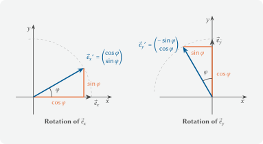

---
kernelspec:
  name: python3
  display_name: 'Python 3'
---

# 5.1 Rotation Matrices for a Robot Arm

In an assembly cell, a **SCARA robot** places electronic parts on circuit
boards. SCARA stands for *Selective Compliance Assembly Robot Arm*: the arm
gives a little in the horizontal direction but is stiff in the vertical
direction. The robot consists of a base and two horizontal arms that rotate
about vertical axes at two joints. The gripper at the end of the second arm
can also move up and down. Many SCARA robots can rotate the gripper about a
vertical axis as well. Where the gripper is in the horizontal plane,
however, depends only on the angles of the two joints. The controller has to
compute this position. *Where does the gripper go when the first joint
rotates by 30°?*

In Chapters 3 and 4 we used matrices to set up and solve systems of
equations. In this chapter, matrices take on a second role: a **rotation
matrix** rotates points about the origin. We use it to compute where the
gripper and the part it holds end up, and we check why the arm keeps its
length as it rotates.

## Where does the gripper go?

For the calculation we look at the robot from above. Both joints rotate about
vertical axes, so the arms move only in the horizontal plane. The vertical
stroke of the gripper only changes its height. For the position in the plane,
the top view is therefore all we need.


A SCARA robot seen from the side and its top view with the arm lengths and
the joint angles.
(Source: figure by the author; license [CC BY-NC-SA 4.0](https://creativecommons.org/licenses/by-nc-sa/4.0))

We place the origin of the coordinate system at joint 1. Arm 1 is
$l_1 = 0.4\,\text{m}$ long, and arm 2 is $l_2 = 0.3\,\text{m}$ long. We
measure the angle $\alpha$ of joint 1 from the $x$-axis and the angle $\beta$
of joint 2 from the extension of arm 1. In this chapter we keep joint 2
straight, i.e. $\beta = 0$. The whole arm then rotates about joint 1 like a
rigid bar. In the **home position** $\alpha = 0$, the arm points along the
$x$-axis. As with the node coordinates in Chapter 4.1, we store the points of
the arm as rows of a 2D array.

```{code-cell} python
import numpy as np
import matplotlib.pyplot as plt

# points of the straight arm in the home position in m, row = [x, y]
arm = np.array([
    [0.0, 0.0],   # joint 1: axis of rotation at the base
    [0.4, 0.0],   # joint 2: end of arm 1
    [0.7, 0.0],   # gripper: end of arm 2
])

print(arm)
```

For plotting, we use a ready-made function, as in Chapter 4. We simply run
the cell and do not need to understand the code in detail.

```{code-cell} python
:tags: [hide-input]
# Given plotting function: just run it, you do not need to understand it.
def plot_robot(arms, parts=None, targets=None, path=None, surroundings=None,
               labels=None, title='', limit=0.8):
    """Plots a robot arm in top view.

    arms: points of an arm as an array, row = [x, y], from the first joint to
          the gripper, or a list of such arrays for several positions
    parts: corner points of the part in the gripper as an array, or a list
           with one array per position (optional)
    targets: target points as an array, row = [x, y], marked as crosses (optional)
    path: gripper positions as an array, row = [x, y], drawn as a dashed
          line with dots (optional)
    surroundings: corner points of areas such as a conveyor belt or a box as
                  an array or a list of arrays, filled in gray (optional)
    labels: legend entries, one per position (optional)
    title: plot title
    limit: visible range from -limit to +limit in m
    """
    blue, red, orange, gray = '#005A94', '#E60000', '#E87846', '#484949'
    colors = [blue, red, orange, gray]
    if isinstance(arms, np.ndarray):
        arms = [arms]
    if isinstance(parts, np.ndarray):
        parts = [parts]
    if isinstance(surroundings, np.ndarray):
        surroundings = [surroundings]
    fig, ax = plt.subplots(figsize=(6, 6))

    # surroundings: areas such as a conveyor belt or a box
    if surroundings is not None:
        for area in surroundings:
            ax.fill(area[:, 0], area[:, 1], facecolor='#DDDEDE',
                    edgecolor=gray, linewidth=1, zorder=0)

    # base at the origin
    ax.add_patch(plt.Circle((0, 0), 0.06, facecolor='#CCDEE9', edgecolor=blue,
                            linewidth=1.5, zorder=1))

    # gripper path as a dashed line with dots
    if path is not None:
        ax.plot(path[:, 0], path[:, 1], color=gray, linestyle='--', linewidth=1,
                marker='o', markersize=3, label='Gripper path', zorder=1)

    # arms: joints as circles, gripper as a square, part filled in yellow
    for k in range(len(arms)):
        color = colors[k % len(colors)]
        points = arms[k]
        label = None if labels is None else labels[k]
        ax.plot(points[:, 0], points[:, 1], color=color, linewidth=6,
                solid_capstyle='round', label=label, zorder=2)
        ax.scatter(points[:-1, 0], points[:-1, 1], s=50, color='white',
                   edgecolor=color, linewidth=2, zorder=3)
        ax.scatter(points[-1, 0], points[-1, 1], s=60, marker='s', color=color,
                   zorder=3)
        if parts is not None:
            corners = parts[k]
            ax.fill(corners[:, 0], corners[:, 1], facecolor='#FFEC7F',
                    edgecolor=color, linewidth=1.5, zorder=4)

    # target points as crosses
    if targets is not None:
        targets = np.atleast_2d(targets)
        ax.scatter(targets[:, 0], targets[:, 1], marker='x', s=80, color=gray,
                   linewidth=2, zorder=5, label='Target')

    if labels is not None or targets is not None or path is not None:
        ax.legend(loc='lower left')
    ax.set_xlim(-limit, limit)
    ax.set_ylim(-limit, limit)
    ax.set_aspect('equal')
    ax.grid(True)
    ax.set_xlabel('x in m')
    ax.set_ylabel('y in m')
    ax.set_title(title)
    plt.show()
```

```{code-cell} python
plot_robot(arm, title='SCARA robot in the home position')
```

If joint 1 rotates by the angle $\alpha$, the gripper moves on a circle of
radius $0.7\,\text{m}$ around the origin. By the definition of cosine and sine
on the circle, it ends up at $(0.7\cos\alpha,\ 0.7\sin\alpha)$. This
reasoning works because the gripper lies on the $x$-axis in the home position.
The part in the gripper, however, has corners off the $x$-axis. We therefore
need a formula that rotates any point $(x, y)$.

To do this, we split the point into its components along the axes. We reach
it by going $x$ steps along the **unit vector** $\vec{e}_x = (1, 0)^\top$ and
$y$ steps along $\vec{e}_y = (0, 1)^\top$. Unit vectors have length 1, and
these two point along the coordinate axes. When we rotate by
the angle $\varphi$, both unit vectors rotate as well.



The two unit vectors before and after a rotation by the angle $\varphi$, with
the components of the rotated vectors.
(Source: figure by the author; license [CC BY-NC-SA 4.0](https://creativecommons.org/licenses/by-nc-sa/4.0))

The figure shows that $\vec{e}_x$ becomes $(\cos\varphi, \sin\varphi)^\top$
and $\vec{e}_y$ becomes $(-\sin\varphi, \cos\varphi)^\top$. The rotated point
is made up of the same components, but now along the rotated unit vectors:

$$\vec{p}^{\,\prime} = x \begin{pmatrix} \cos\varphi \\ \sin\varphi \end{pmatrix}
+ y \begin{pmatrix} -\sin\varphi \\ \cos\varphi \end{pmatrix}
= \begin{pmatrix} x\cos\varphi - y\sin\varphi \\ x\sin\varphi + y\cos\varphi \end{pmatrix}.$$

The right-hand side is exactly what we get when we multiply a matrix by the
vector $(x, y)^\top$. We computed this product row by row in Chapter 3.1:

$$\vec{p}^{\,\prime} =
\underbrace{\begin{pmatrix} \cos\varphi & -\sin\varphi \\ \sin\varphi & \cos\varphi \end{pmatrix}}_{\mathbf{R}(\varphi)}
\begin{pmatrix} x \\ y \end{pmatrix}.$$

The matrix $\mathbf{R}(\varphi)$ is called the **rotation matrix**. Its
columns are the rotated unit vectors. A positive angle rotates
counterclockwise, a negative angle clockwise.

We test the formula on a case we can easily work out in our heads. For
$\varphi = 90°$, we have $\cos 90° = 0$ and $\sin 90° = 1$. The gripper at
$(0.7, 0)$ then ends up at

$$\mathbf{R}(90°) \begin{pmatrix} 0.7 \\ 0 \end{pmatrix}
= \begin{pmatrix} 0 & -1 \\ 1 & 0 \end{pmatrix} \begin{pmatrix} 0.7 \\ 0 \end{pmatrix}
= \begin{pmatrix} 0 \cdot 0.7 + (-1) \cdot 0 \\ 1 \cdot 0.7 + 0 \cdot 0 \end{pmatrix}
= \begin{pmatrix} 0 \\ 0.7 \end{pmatrix}.$$

After a quarter turn, the arm therefore points along the $y$-axis, as
expected.

## Rotations in 3D space

The joints of the SCARA robot rotate about the vertical $z$-axis. In three
dimensions, the rotation matrix for this is

$$\mathbf{R}_z(\varphi) = \begin{pmatrix} \cos\varphi & -\sin\varphi & 0 \\
\sin\varphi & \cos\varphi & 0 \\ 0 & 0 & 1 \end{pmatrix}.$$

The top-left block is our rotation matrix, and the $z$-coordinate stays the
same. That is why the top view is enough for the SCARA robot.

In Python we write the rotation matrix as a function `rotation_matrix(angle)`
that returns a 2×2 array. `np.cos` and `np.sin` expect the angle in
**radians**, not in degrees. `np.deg2rad` does the conversion. We rotate the
point with the matrix multiplication operator `@` from Chapter 3.1.

```{code-cell} python
def rotation_matrix(angle):
    """Rotation matrix for a rotation about the origin, angle in radians."""
    return np.array([
        # TODO: ???   first row of the rotation matrix R(φ)
        # TODO: ???   second row of the rotation matrix R(φ)
    ])

# joint 1 rotates by 30 degrees
# TODO: ???   set up the rotation matrix for 30 degrees and store it in R

# rotate the gripper: rotation matrix times point
gripper = arm[2]
# TODO: ???   rotate the gripper and store the result in gripper_new

print('Rotation matrix R(30°):')
print(np.round(R, 4))
print('Gripper after the rotation in m:', np.round(gripper_new, 4))
```

After the rotation, the gripper is at $(0.606, 0.350)$. This matches our
reasoning on the circle: $0.7\cos 30° = 0.606$ and $0.7\sin 30° = 0.350$. The
first column of the rotation matrix is $(0.866, 0.5)$, i.e. the rotated unit
vector $\vec{e}_x$.

**Angles in radians**

The call `np.cos(30)` interprets 30 as radians, not degrees, and returns
0.154 instead of 0.866 without any error message. We therefore always convert
degrees with `np.deg2rad` first.

## Rotating the whole arm at once

So far we have rotated only the gripper. The controller, however, needs more
points. From the position of joint 2 it can tell whether the arm collides
with anything. From the corners of the part it can tell whether the part lands
correctly on the circuit board. The part is $8\,\text{cm}$ long and
$4\,\text{cm}$ wide. It is centered under the gripper and, in the home
position, lies lengthwise along the arm.

*Do we have to multiply each point by $\mathbf{R}$ separately?* No, we can do
it in one step. The product $\mathbf{R} \cdot \vec{p}$ expects the point as a
column with two entries. Our arrays, on the other hand, store each point as a
row and have the shape `(n, 2)`. The transpose `.T` from Chapter 4.2 swaps
rows and columns. `part.T` has the shape `(2, 4)`, and each column is a
corner. `R @ part.T` multiplies $\mathbf{R}$ by every column at once and again
gives the shape `(2, 4)`. A final `.T` converts the result back to one point
per row.

```{code-cell} python
# corners of the part in the gripper in m, home position, row = [x, y]
part = np.array([
    [0.66, -0.02],
    [0.74, -0.02],
    [0.74,  0.02],
    [0.66,  0.02],
])

# shapes before and after transposing
print('Shape of part:      ', part.shape)
print('Shape of part.T:    ', part.T.shape)
print('Shape of R @ part.T:', (R @ part.T).shape)
```

## Remember: columns in the formula, rows in the array

In mathematics we write a point as a column, so in $\mathbf{R} \cdot \vec{p}$
the matrix is to the left of the point. In our NumPy arrays, on the other
hand, each point is a row. The first `.T` turns the rows into columns, and
the second `.T` turns the columns back into rows.

The rotation matrix `R` is still the rotation by 30° from the previous
section. We use it to rotate the arm and the part and plot both positions.

```{code-cell} python
# rotate all points at once: transpose, multiply, transpose back
# TODO: ???   rotate all points of the arm and store them in arm_rotated
# TODO: ???   rotate all corners of the part and store them in part_rotated

print('Arm after the rotation by 30° in m:')
print(np.round(arm_rotated, 4))

plot_robot([arm, arm_rotated], parts=[part, part_rotated],
           labels=['Home position', 'α = 30°'],
           title='Joint 1 rotates by 30°')
```

Joint 1 stays where it is, because a rotation about the origin does not move
the origin. Joint 2 ends up at $(0.346, 0.200)$, and the gripper, as before,
at $(0.606, 0.350)$. Both move on circles around joint 1. The part, however,
does more than move along. It also rotates: its long edge is now tilted by
30° relative to the $x$-axis. A rotation therefore changes not only the
position of a body but also its **orientation**, i.e. how it is aligned.

## Why does the arm keep its length?

A rigid arm must neither stretch nor compress when it rotates. We first check
whether our calculation respects this. As with the member length in
Chapter 4.1, we compute the distance of the gripper from joint 1 with the
Pythagorean theorem, $\sqrt{x^2 + y^2}$.

```{code-cell} python
# rotation by 30 degrees as in the previous section
R = rotation_matrix(np.deg2rad(30))
arm_rotated = (R @ arm.T).T

# distance of the gripper from joint 1 (Pythagorean theorem), before and after the rotation
distance_before = np.sqrt(arm[2, 0]**2 + arm[2, 1]**2)
distance_after = np.sqrt(arm_rotated[2, 0]**2 + arm_rotated[2, 1]**2)

print(f'Distance before: {distance_before:.4f} m')
print(f'Distance after:  {distance_after:.4f} m')
```

The distance is $0.7\,\text{m}$ before and after the rotation. *Is that due to
the numbers we chose, or does it hold for every angle?* The answer lies in the
rotation matrix itself. We multiply its transpose by $\mathbf{R}$:

$$\mathbf{R}^\top \mathbf{R}
= \begin{pmatrix} \cos\varphi & \sin\varphi \\ -\sin\varphi & \cos\varphi \end{pmatrix}
  \begin{pmatrix} \cos\varphi & -\sin\varphi \\ \sin\varphi & \cos\varphi \end{pmatrix}
= \begin{pmatrix} \cos^2\varphi + \sin^2\varphi & 0 \\ 0 & \sin^2\varphi + \cos^2\varphi \end{pmatrix}
= \begin{pmatrix} 1 & 0 \\ 0 & 1 \end{pmatrix}.$$

Off the diagonal, the terms cancel, for example in the top right:
$\cos\varphi \cdot (-\sin\varphi) + \sin\varphi \cdot \cos\varphi = 0$. On the
diagonal we get $\cos^2\varphi + \sin^2\varphi = 1$, which is the Pythagorean
theorem on the unit circle. The result is the **identity matrix**
$\mathbf{I}$, with ones on the diagonal and zeros everywhere else. A matrix
with $\mathbf{R}^\top \mathbf{R} = \mathbf{I}$ is called an **orthogonal
matrix**. Orthogonal matrices change neither lengths nor angles. That is why
the arm and the part keep their shape, whatever the angle of rotation.

In Python, `np.eye(2)` creates the 2×2 identity matrix. We compare the
result with `np.allclose` from Chapter 3.1, because cosine and sine involve
small rounding errors. In addition, we compute the determinant with
`np.linalg.det`.

```{code-cell} python
# R transposed times R should give the identity matrix
# TODO: ???   multiply the transpose of R by R and store the result in product
print(np.round(product, 4))
print('R^T R equals identity matrix:', np.allclose(product, np.eye(2)))

# determinant of the rotation matrix
print(f'Determinant of R: {np.linalg.det(R):.4f}')
```

The calculation confirms $\mathbf{R}^\top \mathbf{R} = \mathbf{I}$. The
determinant is 1. It is therefore nonzero, so, as we saw in Chapter 3.1, the
rotation can be uniquely reversed. The equation
$\mathbf{R}^\top \mathbf{R} = \mathbf{I}$ tells us directly how: the
transpose undoes the rotation. A matrix that undoes the
effect of another matrix is called its **inverse matrix** $\mathbf{R}^{-1}$.
For rotation matrices, the inverse is simply the transpose,
$\mathbf{R}^{-1} = \mathbf{R}^\top$. For the robot this means: if we multiply
the rotated arm by $\mathbf{R}^\top$, it moves back to the home position.

```{code-cell} python
# back to the home position: rotate with the transposed rotation matrix
# TODO: ???   rotate the rotated arm back and store it in arm_back

print(np.round(arm_back, 4))
print('Home position reached:', np.allclose(arm_back, arm))
```

The arm is back in the home position. The output shows `-0.` in some places.
These are tiny negative rounding errors on the order of $10^{-18}$, which
`np.round` displays as $-0$. Here, too, we therefore compare with
`np.allclose` and not with `==`.

## Summary and outlook

A rotation matrix $\mathbf{R}(\varphi)$ rotates points about the origin. Its
columns are the rotated unit vectors, and a positive angle rotates
counterclockwise. If we store many points as rows of an array, we rotate all
of them in one step with `(R @ points.T).T`. Because
$\mathbf{R}^\top \mathbf{R} = \mathbf{I}$, the rotation matrix is orthogonal:
it preserves lengths and angles, and its transpose undoes the rotation. For
our SCARA robot this means that we can compute the position of the arm, the
gripper and the part from the angle of joint 1.

In Chapter 5.2, we apply the rotation matrix in a project: a swivel arm moves
parts from a conveyor belt into a box. So far, joint 2 of our SCARA robot has
stayed straight. If it rotates as well, its axis of rotation is no longer at
the origin but at the end of arm 1. A rotation matrix alone is then not
enough. Chapter 5.3 shows how to combine rotation and translation in
a single matrix using **homogeneous coordinates**.

## Mini-exercises

### Mini-exercise 1

1. Answer without code: where is the gripper at $\alpha = 180°$, and where
   at $\alpha = -90°$?
2. Use `rotation_matrix` to compute the position of the gripper for
   $\alpha = 135°$.
3. Answer without code: why do the two coordinates from task 2 have the same
   absolute value?

```{code-cell} python
# code cell
```

### Mini-exercise 2

1. Rotate the arm and the part by $\alpha = -60°$ and plot the home position
   and the rotated position with `plot_robot`.
2. Answer without code: what are the shapes of `arm.T` and `R @ arm.T`?
3. Answer without code: the part is supposed to land on the circuit board
   aligned with the $x$-axis. What happens if the robot puts it down at
   $\alpha = -60°$? What else would the robot need to be able to do?

```{code-cell} python
# code cell
```

### Mini-exercise 3

1. Compute the length of the long edge of the part, i.e. the distance between
   corners 0 and 1, before and after the rotation by $30°$.
2. Use `np.allclose` to check that $\mathbf{R}^\top \mathbf{R}$ also gives
   the identity matrix for $\varphi = 135°$.
3. Answer without code: $\mathbf{R}(30°)^\top$ rotates the arm back to the
   home position. Which rotation does $\mathbf{R}(30°)^\top$ correspond to?
   Hint: $\cos(-\varphi) = \cos\varphi$ and $\sin(-\varphi) = -\sin\varphi$.

```{code-cell} python
# code cell
```
