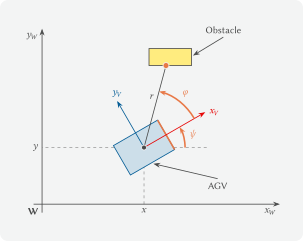

---
kernelspec:
  name: python3
  display_name: 'Python 3'
---

# 6.1 Vehicle and World Coordinates

In a warehouse, an **automated guided vehicle**, or AGV for short, brings
boxes to a transfer station. Several such vehicles together with their
control system form an **automated guided vehicle system**. The AGV uses a
laser scanner to find its way. When the scanner reports an obstacle
$1.5\,\text{m}$ ahead, the controller only knows where the obstacle is
relative to the vehicle. *Where is the obstacle in the warehouse?*

In Chapter 5.3 we rotated and shifted points within one common coordinate
system. Now the warehouse and the vehicle each have their own coordinate
system, and the same matrix converts coordinates from one to the other.

## Where is the vehicle in the warehouse?

As with the SCARA robot, we look at the warehouse from above and need two
coordinate systems:

* The **world coordinate system** W is fixed to the warehouse. Its origin is
  in the lower left corner of our section of the warehouse. The warehouse map
  is given in this coordinate system.
* The **vehicle coordinate system** V moves with the vehicle. Its origin is
  at the center of the vehicle, the $x_V$-axis points forward and the
  $y_V$-axis to the left, as specified in the standard ISO 8855.



The world coordinate system W, the vehicle coordinate system V with the pose
$(x, y, \psi)$ and a measurement of the laser scanner with distance $r$ and
angle $\varphi$.
(Source: figure by the author; license [CC BY-NC-SA 4.0](https://creativecommons.org/licenses/by-nc-sa/4.0))

Together, the position $(x, y)$ of the vehicle center and the **yaw angle**
$\psi$ (psi) between the $x_W$-axis and the $x_V$-axis are called the
**pose** of the vehicle. As in Chapter 5.1, positive yaw angles rotate
counterclockwise.

First we run two cells: the given plotting function `plot_warehouse` and a
cell with `transformation_matrix` and `transform` from Chapter 5.3 and the
warehouse map. It also contains the `outline` of the AGV, which is
$1.2\,\text{m}$ long and $0.8\,\text{m}$ wide. In vehicle coordinates, its
corners are always in the same places, and the first two form the front
edge.

```{code-cell} python
:tags: [hide-input]
# Given plotting function: just run it, you do not need to understand it.
def plot_warehouse(vehicles=None, coordinate_systems=None, scan_points=None,
                   scanner=None, protective_field=None, targets=None, path=None,
                   surroundings=None, labels=None, title='',
                   limits=(0, 10, 0, 8)):
    """Plots a section of the warehouse in top view.

    vehicles: corners of a vehicle outline as an array, row = [x, y], the
              first two corners form the front edge, or a list of such
              arrays for several vehicles (optional)
    coordinate_systems: homogeneous 3x3 matrix of a coordinate system or a
              list of such matrices, the x-axis (red) and the y-axis (blue)
              are drawn 0.8 m long (optional)
    scan_points: scan points as an array, row = [x, y], drawn as red dots
                 (optional)
    scanner: position [x, y] of the scanner, draws the laser beams from the
             scanner to the scan points as thin red lines (optional)
    protective_field: corners of a protective field as an array, row = [x, y],
                      filled in yellow with a dashed outline (optional)
    targets: target points as an array, row = [x, y], marked as crosses (optional)
    path: path points as an array, row = [x, y], drawn as a dashed line with
          dots on top of the vehicles (optional)
    surroundings: corners of areas such as racks or pallets as an array or a
                  list of arrays, filled in gray (optional)
    labels: legend entries, one per vehicle; without labels, all vehicles
            are outlined in blue (optional)
    title: plot title
    limits: visible section (x_min, x_max, y_min, y_max) in m
    """
    blue, red, orange, gray = '#005A94', '#E60000', '#E87846', '#484949'
    colors = [blue, red, orange, gray]
    if isinstance(vehicles, np.ndarray):
        vehicles = [vehicles]
    if isinstance(coordinate_systems, np.ndarray):
        coordinate_systems = [coordinate_systems]
    if isinstance(surroundings, np.ndarray):
        surroundings = [surroundings]
    fig, ax = plt.subplots(figsize=(7, 6))

    # surroundings: racks, pallets, pillars
    if surroundings is not None:
        for area in surroundings:
            ax.fill(area[:, 0], area[:, 1], facecolor='#DDDEDE',
                    edgecolor=gray, linewidth=1, zorder=0)

    # protective field filled in yellow with a dashed outline
    if protective_field is not None:
        ax.fill(protective_field[:, 0], protective_field[:, 1],
                facecolor='#FFEC7F', edgecolor=orange, linestyle='--',
                linewidth=1.5, label='Protective field', zorder=1)

    # path as a dashed line with dots, on top of the vehicles
    if path is not None:
        ax.plot(path[:, 0], path[:, 1], color=gray, linestyle='--', linewidth=1,
                marker='o', markersize=3, label='Path', zorder=4)

    # vehicles: outline filled in light blue, front edge (corner 0 to corner 1) orange
    if vehicles is not None:
        for k in range(len(vehicles)):
            color = blue if labels is None else colors[k % len(colors)]
            corners = vehicles[k]
            label = None if labels is None else labels[k]
            ax.fill(corners[:, 0], corners[:, 1], facecolor='#CCDEE9',
                    edgecolor=color, linewidth=2, label=label, zorder=2)
            ax.plot(corners[0:2, 0], corners[0:2, 1], color=orange, linewidth=4,
                    solid_capstyle='butt', zorder=3)

    # coordinate systems: x-axis red, y-axis blue, each 0.8 m long
    if coordinate_systems is not None:
        for T in coordinate_systems:
            origin = T[0:2, 2]
            for column, color, name in [(0, red, 'x'), (1, blue, 'y')]:
                tip = origin + 0.8 * T[0:2, column]
                ax.annotate('', xy=tip, xytext=origin, zorder=4,
                            arrowprops=dict(arrowstyle='-|>', color=color, lw=2))
                label_position = origin + 1.0 * T[0:2, column]
                ax.text(label_position[0], label_position[1], name, color=color,
                        ha='center', va='center', fontsize=11, zorder=4)
            ax.scatter(origin[0], origin[1], s=25, color=gray, zorder=5)

    # scan points as red dots, optionally with laser beams from the scanner
    if scan_points is not None:
        scan_points = np.atleast_2d(scan_points)
        if scanner is not None:
            for point in scan_points:
                ax.plot([scanner[0], point[0]], [scanner[1], point[1]], color=red,
                        linewidth=0.8, alpha=0.6, zorder=4)
        ax.scatter(scan_points[:, 0], scan_points[:, 1], s=25, color=red,
                   zorder=5, label='Scan points')

    # target points as crosses
    if targets is not None:
        targets = np.atleast_2d(targets)
        ax.scatter(targets[:, 0], targets[:, 1], marker='x', s=80, color=gray,
                   linewidth=2, zorder=5, label='Target')

    if (labels is not None or scan_points is not None or targets is not None
            or path is not None or protective_field is not None):
        ax.legend(loc='upper left')
    ax.set_xlim(limits[0], limits[1])
    ax.set_ylim(limits[2], limits[3])
    ax.set_aspect('equal')
    ax.grid(True)
    ax.set_xlabel('x in m')
    ax.set_ylabel('y in m')
    ax.set_title(title)
    plt.show()
```

```{code-cell} python
import numpy as np
import matplotlib.pyplot as plt

# functions from Chapter 5.3
def transformation_matrix(angle, tx, ty):
    """Homogeneous matrix: rotate by angle (radians), then shift by (tx, ty)."""
    return np.array([
        [np.cos(angle), -np.sin(angle), tx],
        [np.sin(angle),  np.cos(angle), ty],
        [0.0,            0.0,           1.0],
    ])

def transform(T, points):
    """Applies the homogeneous matrix T to all points, row = [x, y]."""
    points_hom = np.ones((len(points), 3))
    points_hom[:, 0:2] = points
    result = (T @ points_hom.T).T
    return result[:, 0:2]

# corners of the AGV in the vehicle coordinate system in m, row = [x, y]
outline = np.array([
    [ 0.6, -0.4],   # front right
    [ 0.6,  0.4],   # front left
    [-0.6,  0.4],   # rear left
    [-0.6, -0.4],   # rear right
])

# warehouse map: corners of the rack, the pallet and the pillar in warehouse
# coordinates in m
rack = np.array([[0.5, 6.5], [9.5, 6.5], [9.5, 7.5], [0.5, 7.5]])
pallet = np.array([[5.6, 4.0], [6.8, 4.0], [6.8, 4.8], [5.6, 4.8]])
pillar = np.array([[6.3, 0.3], [6.7, 0.3], [6.7, 0.7], [6.3, 0.7]])
warehouse = [rack, pallet, pillar]
```

We move the vehicle into its pose the same way as the part in Chapter 5.3:
first rotate by $\psi$, then shift by $(x, y)$. The homogeneous
transformation matrix does exactly this:

$$\mathbf{T}_{WV} = \begin{pmatrix} \cos\psi & -\sin\psi & x \\
\sin\psi & \cos\psi & y \\ 0 & 0 & 1 \end{pmatrix}.$$

## Subscript notation

We read the subscripts from right to left: $\mathbf{T}_{WV}$ converts
coordinates from system V to system W. For a point in homogeneous coordinates
from Chapter 5.3, we have
$\tilde{p}_W = \mathbf{T}_{WV} \cdot \tilde{p}_V$.

Our AGV is at $(4, 2)$ with $\psi = 30°$. The parameter `coordinate_systems`
additionally draws the axes of the vehicle coordinate system.

```{code-cell} python
# pose of the AGV: center at (4, 2) m, yaw angle 30 degrees
# TODO: ???   set up the transformation matrix for this pose and store it in T_WV
print('T_WV:')
print(np.round(T_WV, 4))

# convert the corners of the vehicle from vehicle to warehouse coordinates
# TODO: ???   convert the outline to warehouse coordinates and store it in outline_W
print('Corners in warehouse coordinates in m:')
print(np.round(outline_W, 3))

plot_warehouse(outline_W, coordinate_systems=T_WV, surroundings=warehouse,
               title='AGV in the warehouse')
```

The red axis $x_V$ points forward, the blue axis $y_V$ to the left. *Where do
we find these axes in the matrix?* The first column of $\mathbf{T}_{WV}$,
$(0.866, 0.5)$, is the direction of the $x_V$-axis in warehouse coordinates,
the second column is the direction of the $y_V$-axis, and the third is the
vehicle center $(4, 2)$. So a point with the vehicle coordinates
$(x_V, y_V)$ lies at the vehicle center plus $x_V$ times the first column
plus $y_V$ times the second column.

We can therefore read $\mathbf{T}_{WV}$ in two ways: as a motion that brings
the vehicle from the origin into its pose, like the robot arm in Chapter 5.3,
or as a conversion of the same corners from vehicle to warehouse
coordinates. Both views give the same numbers.

## Where is the obstacle in the warehouse?

The scanner sits at the center of the vehicle, i.e. at the origin of the
vehicle coordinate system. For each laser beam, it measures the distance $r$
to the first object and gives the direction as the angle $\varphi$ measured
from the $x_V$-axis, positive to the left, as in the figure above.

## Math refresher: polar coordinates

A point at the distance $r$ from the origin and at the angle $\varphi$
measured from the $x$-axis has the **polar coordinates** $(r, \varphi)$ and
the Cartesian coordinates $x = r \cos\varphi$, $y = r \sin\varphi$. This is
how we computed the gripper on its circle in Chapter 5.1.

The obstacle from the beginning has $r = 1.5$ and $\varphi = 0$, so its
vehicle coordinates are $(1.5, 0)$. `transform` expects one point per row, so
we write the single point with double square brackets as an array of shape
`(1, 2)`.

```{code-cell} python
# obstacle 1.5 m ahead: r = 1.5 m and phi = 0, i.e. (1.5, 0) in vehicle coordinates
obstacle_V = np.array([[1.5, 0.0]])
obstacle_W = transform(T_WV, obstacle_V)
print('Obstacle in warehouse coordinates in m:', np.round(obstacle_W, 3))
```

The obstacle is at $(5.299, 2.750)$. With a different pose, it would have
completely different warehouse coordinates. The measurement alone therefore
does not tell us where the obstacle is in the warehouse. For that, we need
the pose.

Five beams have hit an object to the front left of the vehicle. As in
Chapter 2.1, we apply the formulas for polar coordinates to whole arrays and
enter $x_V$ and $y_V$ into the columns of an array of shape `(5, 2)`. The
parameter `scanner` draws the laser beams starting from the vehicle center,
i.e. from the third column of $\mathbf{T}_{WV}$.

```{code-cell} python
# five scanner measurements: distance in m and angle in degrees
distances = np.array([3.11, 2.83, 2.61, 2.79, 3.20])
angles_deg = np.array([10, 15, 20, 25, 30])

# convert polar coordinates to vehicle coordinates, all measurements at once
angles = np.deg2rad(angles_deg)
scan_points_V = np.zeros((len(distances), 2))
# TODO: ???   first column of scan_points_V: x_V of all scan points
# TODO: ???   second column of scan_points_V: y_V of all scan points

# convert from vehicle to warehouse coordinates
scan_points_W = transform(T_WV, scan_points_V)
print('Scan points in warehouse coordinates in m:')
print(np.round(scan_points_W, 3))

plot_warehouse(outline_W, scan_points=scan_points_W, scanner=T_WV[0:2, 2],
               surroundings=warehouse, title='What the scanner sees')
```

All five scan points lie on the bottom and left edges of the pallet. Values
such as $3.999$ instead of $4$ occur because the scanner rounds the distances
to centimeters.

## Where is the transfer station from the vehicle's point of view?

For the drive to the transfer station at $(8, 2.5)$, the controller needs the
opposite direction. The vehicle coordinates of the station tell us whether it
is in front ($x_V > 0$) or behind, and whether the AGV has to steer left
($y_V > 0$) or right. *Which matrix converts from W to V?*

## Math refresher: inverse matrix

The **inverse matrix** $\mathbf{A}^{-1}$ undoes the effect of $\mathbf{A}$,
i.e. $\mathbf{A}^{-1} \mathbf{A} = \mathbf{I}$. It exists if
$\det(\mathbf{A}) \neq 0$. For rotation matrices, it is the transpose
(Chapter 5.1). Like the rotation matrix, our homogeneous matrices have the
determinant 1 and can always be inverted.

So $\mathbf{T}_{VW} = \mathbf{T}_{WV}^{-1}$ converts from W to V. NumPy
computes the inverse with `np.linalg.inv`. As a check,
$\mathbf{T}_{VW} \cdot \mathbf{T}_{WV}$ must give the identity matrix
`np.eye(3)` from Chapter 5.1.

```{code-cell} python
# transfer station in warehouse coordinates in m, as an array of shape (1, 2)
station = np.array([[8.0, 2.5]])

# from warehouse to vehicle coordinates: with the inverse matrix
# TODO: ???   compute the inverse of T_WV and store it in T_VW
print('T_VW:')
print(np.round(T_VW, 4))
print('T_VW @ T_WV equals the identity matrix:', np.allclose(T_VW @ T_WV, np.eye(3)))

# TODO: ???   convert the station to vehicle coordinates and store it in station_V
print('Station in vehicle coordinates in m:', np.round(station_V, 3))

plot_warehouse(outline_W, coordinate_systems=T_WV, targets=station,
               surroundings=warehouse, title='Where is the transfer station?')
```

The station is $3.714\,\text{m}$ ahead of the vehicle center and
$1.567\,\text{m}$ to the right of it, so the AGV has to steer right. The top
left of $\mathbf{T}_{VW}$ contains the reverse rotation $\mathbf{R}(-30°)$.
The right column, however, is not $(-4, -2)$: $\mathbf{T}_{WV}$ first rotated
and then shifted, so the inverse has to shift back first and then rotate
back. In doing so, the reverse rotation also rotates the translation vector.

## Summary and outlook

The warehouse and the vehicle each have their own coordinate system. The pose
$(x, y, \psi)$ determines where the vehicle coordinate system is and where it
points. $\mathbf{T}_{WV}$ converts vehicle coordinates to warehouse
coordinates, and its columns contain the vehicle axes and the vehicle center.
We convert scanner measurements to vehicle coordinates with
$x = r\cos\varphi$ and $y = r\sin\varphi$. The opposite direction is handled
by $\mathbf{T}_{VW} = \mathbf{T}_{WV}^{-1}$, which we compute with
`np.linalg.inv`.

In the project in Chapter 6.2, a second scanner sits at the front of the
vehicle and brings a third coordinate system with it. As in Chapter 5.3, we
therefore chain two transformations and check whether the AGV has to stop.

## Mini-exercises

### Mini-exercise 1

1. Answer without code: a second AGV is at $(2, 5)$ with $\psi = 180°$. In
   which direction of the warehouse does its $x_V$-axis point? Where is its
   front left corner?
2. Check your answer with `transformation_matrix` and `transform`. Plot both
   vehicles with their coordinate systems in one figure.
3. Answer without code: the first AGV drives $1\,\text{m}$ straight ahead.
   Which columns of $\mathbf{T}_{WV}$ change, and which stay the same? What
   changes if it turns on the spot instead?

```{code-cell} python
# code cell
```

### Mini-exercise 2

Four more beams hit an object to the front right of the vehicle:

| Angle $\varphi$ in degrees | Distance $r$ in m |
| --- | --- |
| $-66$ | $2.84$ |
| $-63$ | $2.74$ |
| $-60$ | $2.66$ |
| $-57$ | $2.86$ |

1. Answer without code: what sign does $y_V$ have for these scan points, and
   why?
2. Convert the measurements to warehouse coordinates and plot them together
   with the warehouse map. Which object did the scanner hit?
3. Answer without code: why do the scan points on the pallet lie on only two
   of its four edges?

```{code-cell} python
# code cell
```

### Mini-exercise 3

1. Answer without code: the vehicle is at $(4, 2)$ and points in the
   $y_W$-direction with $\psi = 90°$. Is the station at $(8, 2.5)$ in front
   of or behind the vehicle, to its left or to its right? How far in each
   case?
2. Check your answer with `np.linalg.inv` and `transform`.
3. Back to the original pose at $(4, 2)$ with $\psi = 30°$: it is tempting to
   simply write the inverse of $\mathbf{T}_{WV}$ as
   `transformation_matrix(np.deg2rad(-30), -4, -2)`. Use `np.allclose` to
   check whether this is correct. Explain the result without code.

```{code-cell} python
# code cell
```
