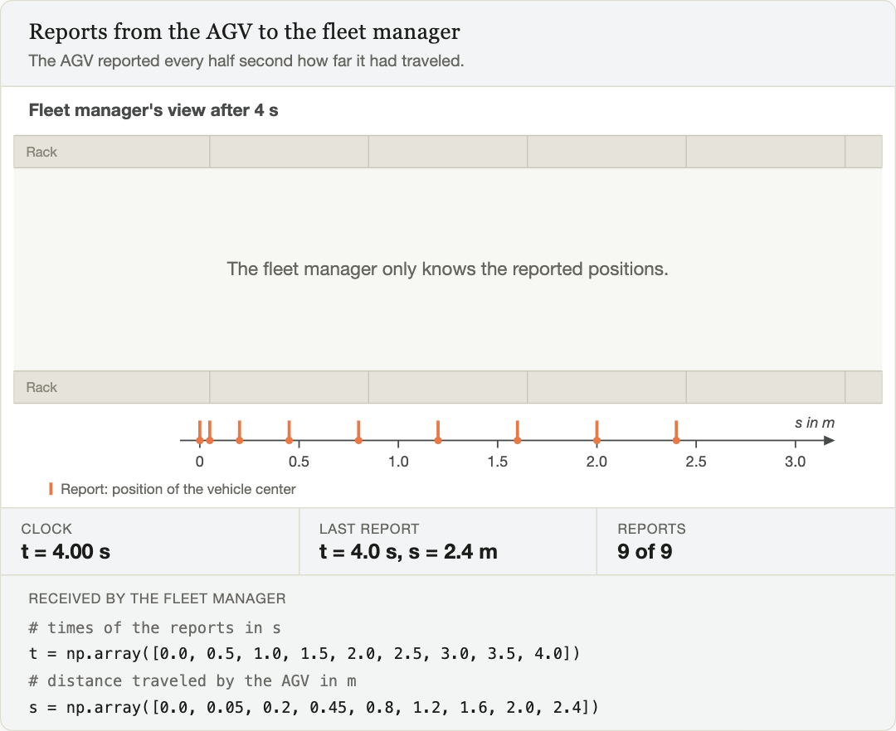

---
kernelspec:
  name: python3
  display_name: 'Python 3'
---

# 7.1 Velocity from Position Data

In Chapter 6.3 we computed the direction of a path from two neighboring path
points and saw that the secant only approximates the tangent. Now the AGV
starts off in a straight line along the main aisle of the warehouse. We know
its position only at individual times, as a sequence of numbers and not as a
formula. *How fast was the AGV at each of these times?*

The velocity is the derivative of the distance with respect to time. Without
a formula, we cannot differentiate the way we do in math class. So we
approximate the derivative from the measured values. This approximation is
called **numerical differentiation**.

## How fast was the AGV between two reports?

The AGV is waiting at the start of the main aisle and drives off in a
straight line. Every half second, it reports to the fleet manager how far it has
traveled. For now, we assume that these reports are exact. The following
applet shows the AGV starting off in slow motion. With "To next report", the
AGV drives on until the next report and stops there. In the fleet manager's
view, the AGV disappears, and only what the fleet manager receives remains.



Interactive version: [open the applet in the browser](https://gramschs.github.io/thma_anm_assets/interactive/chapter07/chap07_sec01_ftf_meldungen.html?lang=en)

The times of the reports are stored in the array `t`, the distances traveled
in the array `s`. We call the time between two reports the **step size**
$\Delta t$, or `dt` in the code.

```{code-cell} python
import numpy as np
import matplotlib.pyplot as plt

# step size: time between two reports in s
dt = 0.5
# times of the reports in s
t = np.array([0.0, 0.5, 1.0, 1.5, 2.0, 2.5, 3.0, 3.5, 4.0])
# distance traveled by the AGV in m
s = np.array([0.0, 0.05, 0.2, 0.45, 0.8, 1.2, 1.6, 2.0, 2.4])
```

A plot shows how the distance grows over time.

```{code-cell} python
# plot: distance over time
fig, ax = plt.subplots(figsize=(7, 4))
ax.plot(t, s, marker='o')
ax.set_xlabel('Time in s')
ax.set_ylabel('Distance in m')
ax.set_title('AGV starting off in the main aisle')
ax.grid(True)
plt.show()
```

At first, the graph gets steeper and steeper, and after that it is a straight
line. This suggests that the AGV first speeds up and then continues at a
constant speed. The marks in the applet show the same thing: the gaps between
them first grow and then stay the same. To find out exactly how fast, we
compute it from the measured values. Between two reports, the AGV covers the
distance $s_{k+1} - s_k$ in the time $\Delta t$. The quotient is the average
velocity in this time interval:

$$\bar{v}_k = \frac{s_{k+1} - s_k}{\Delta t}.$$

We compute all values in a loop and collect them in an array that we create
beforehand with `np.zeros()`. Nine reports mark off eight time intervals.

```{code-cell} python
# average velocity in the time interval from t[k] to t[k + 1]
v_avg = np.zeros(len(s) - 1)
for k in range(len(s) - 1):
    v_avg[k] = (s[k + 1] - s[k]) / dt
print('Average velocities in m/s:', v_avg)
```

In the first interval, the AGV moves at only $0.1\,\text{m/s}$ on average.
From one interval to the next, the average velocity then increases by
$0.2\,\text{m/s}$ each time, to $0.3\,\text{m/s}$, $0.5\,\text{m/s}$ and
$0.7\,\text{m/s}$. From the fifth interval on, it stays at $0.8\,\text{m/s}$.
So the measured values fit an AGV that accelerates uniformly and then moves
at constant velocity. They do not tell us what exactly happens between two
reports.

`ax.plot()` connected the data points with line segments. Each of these
segments is a **secant**, and its slope is exactly the average velocity. A
quotient of two differences such as $(s_{k+1} - s_k) / \Delta t$ is called a
**difference quotient**.

## Math refresher: derivative

As $\Delta t$ approaches zero, the secant becomes the **tangent** and the
difference quotient becomes the **derivative** $s'(t)$, i.e. the
instantaneous velocity $v(t)$. Measured values, however, are only available
at intervals of $\Delta t$. That is why the difference quotient remains an
approximation. You can review the basics in the
[Preparation](chapter07_sec00.md).

## Which point in time does the value belong to?

So far, each value belongs to a time interval. For a plot of the velocity,
however, we need one value per report. There are three ways to get one. At
the time $t_k$,

* the **forward difference quotient** uses the next report:
  $v_k \approx (s_{k+1} - s_k) / \Delta t$,
* the **backward difference quotient** uses the previous report:
  $v_k \approx (s_k - s_{k-1}) / \Delta t$,
* the **central difference quotient** uses both neighbors:
  $v_k \approx (s_{k+1} - s_{k-1}) / (2 \Delta t)$.

We try all three at $t_2 = 1\,\text{s}$. For comparison, we reveal how the
fleet manager planned the drive: the AGV accelerates uniformly at
$0.4\,\text{m/s}^2$ for $2\,\text{s}$ and then continues at
$0.8\,\text{m/s}$. So at $t = 1\,\text{s}$, it is moving at exactly
$0.4\,\text{m/s}$.

```{code-cell} python
# three difference quotients at the time t[2] = 1 s
k = 2
# TODO: ???   compute the forward difference quotient at point k and store it in v_forward
# TODO: ???   compute the backward difference quotient at point k and store it in v_backward
# TODO: ???   compute the central difference quotient at point k and store it in v_central

# output of the difference quotients
print(f'Forward:  {v_forward:.2f} m/s')
print(f'Backward: {v_backward:.2f} m/s')
print(f'Central:  {v_central:.2f} m/s')
print('Planned:  0.40 m/s')
```

The forward difference quotient is $0.1\,\text{m/s}$ too high, the backward
difference quotient $0.1\,\text{m/s}$ too low. *Why?* The forward difference
quotient is the average velocity from $1.0\,\text{s}$ to $1.5\,\text{s}$.
With uniform acceleration, the AGV reaches this average velocity at the
midpoint of the interval, i.e. at $1.25\,\text{s}$, half a step too late. In
the same way, the backward difference quotient belongs to $0.75\,\text{s}$.
The central difference quotient is the mean of the two, so their errors
cancel out. It fits the time $t_k$ itself.

We can only form the central difference quotient in the interior of the
measurement series. The first point has no predecessor, and the last point
has no successor. There we fall back on the forward and the backward
difference quotient. Since we will need this calculation again, we write it
as a function `derivative(values, dt)`.

```{code-cell} python
def derivative(values, dt):
    """Derivative of a measurement series with step size dt.

    Central difference quotient at the interior points, forward at the
    first point, backward at the last point.
    """
    n = len(values)
    result = np.zeros(n)

    # endpoints: one-sided difference quotients
    result[0] = (values[1] - values[0]) / dt
    result[-1] = (values[-1] - values[-2]) / dt

    # interior points: central difference quotient
    for k in range(1, n - 1):
        result[k] = (values[k + 1] - values[k - 1]) / (2 * dt)
    return result
```

With `derivative()`, we now compute the velocity at every report and compare
it with the fleet manager's plan.

```{code-cell} python
# velocity planned by the fleet manager, for comparison
v_plan = np.array([0.0, 0.2, 0.4, 0.6, 0.8, 0.8, 0.8, 0.8, 0.8])

# velocity of the AGV
v = derivative(s, dt)

# output: computed and planned velocity
print('Computed in m/s:', v)
print('Planned in m/s: ', v_plan)
```

The plot shows at which times the computed velocity differs from the planned
one.

```{code-cell} python
# plot: computed and planned velocity
fig, ax = plt.subplots(figsize=(7, 4))
ax.plot(t, v_plan, color='gray', linestyle='--', label='planned')
ax.plot(t, v, marker='o', label='computed')
ax.set_xlabel('Time in s')
ax.set_ylabel('Velocity in m/s')
ax.set_title('Velocity of the AGV while starting off')
ax.legend()
ax.grid(True)
plt.show()
```

At seven of the nine times, the computed velocity matches the planned one. At
the start, the forward difference quotient gives $0.1\,\text{m/s}$ instead
of $0$. We already know this error of half a step. At $t = 2\,\text{s}$, the
acceleration stops abruptly, and the graph of the velocity has a kink there.
The central difference quotient averages over the interval from
$1.5\,\text{s}$ to $2.5\,\text{s}$ and gives $0.75\,\text{m/s}$ instead of
$0.8\,\text{m/s}$. So at kinks, it is off as well.

NumPy provides the same calculation as the function `np.gradient(values, dt)`.
Because we wrote our own function `derivative()`, we know what goes on inside
it.

## What does measurement noise do?

So far, the positions matched the planned motion exactly. However, the AGV
keeps determining its position itself, for example from the measurements of
its scanner, and each of these position estimates is off by a few
millimeters. This random fluctuation of the measured values is called
**measurement noise**. We now evaluate the log that the AGV recorded ten
times per second during the same drive.

```{code-cell} python
# AGV log: step size in s and times 0.0, 0.1, ..., 4.0 s
dt_meas = 0.1
t_meas = np.linspace(0, 4, 41)
# measured distance in m, rounded to millimeters
s_meas = np.array([
    0.000, 0.003, 0.007, 0.014, 0.030, 0.046, 0.072, 0.103, 0.126, 0.160,
    0.202, 0.243, 0.288, 0.334, 0.392, 0.453, 0.507, 0.576, 0.640, 0.717,
    0.793, 0.879, 0.955, 1.041, 1.121, 1.199, 1.270, 1.358, 1.440, 1.520,
    1.594, 1.678, 1.756, 1.837, 1.924, 1.997, 2.080, 2.164, 2.238, 2.320,
    2.400,
])
```

From the positions, we compute the velocity with `derivative()`. If we apply
the function to the velocity, we get the **acceleration** $a$, the derivative
of the velocity with respect to time. The plan was $0.4\,\text{m/s}^2$ until
$t = 2\,\text{s}$ and $0\,\text{m/s}^2$ after that.

```{code-cell} python
# velocity: differentiate once, acceleration: differentiate again
v_meas = derivative(s_meas, dt_meas)
# TODO: ???   compute the acceleration by differentiating the velocity and store it in a_meas
print(f'Acceleration from {np.min(a_meas):.2f} to {np.max(a_meas):.2f} m/s²')
```

The acceleration varies between $-0.43$ and $0.70\,\text{m/s}^2$, although
the AGV only ever accelerates at $0.4$ or $0\,\text{m/s}^2$. To see where the
deviations are, we plot velocity and acceleration one above the other.

```{code-cell} python
# plot: velocity and acceleration, one above the other
fig, ax = plt.subplots(nrows=2, ncols=1, figsize=(7, 6))

ax[0].plot(t, v_plan, color='gray', linestyle='--', label='planned')
ax[0].plot(t_meas, v_meas, marker='.', label='from measurement')
ax[0].set_ylabel('Velocity in m/s')

# planned acceleration: 0.4 m/s² until t = 2 s, 0 after that
ax[1].plot([0, 2, 2, 4], [0.4, 0.4, 0, 0], color='gray', linestyle='--',
           label='planned')
ax[1].plot(t_meas, a_meas, marker='.', label='from measurement')
ax[1].set_ylabel('Acceleration in m/s²')

for single_axis in ax:
    single_axis.set_xlabel('Time in s')
    single_axis.legend()
    single_axis.grid(True)

ax[0].set_title('AGV starting off, with measurement noise')
plt.tight_layout()
plt.show()
```

The velocity follows the plan but jitters by a few centimeters per second.
The acceleration is barely recognizable. *Why does differentiation amplify
the small measurement errors so much?*

Suppose a single position $s_k$ is $5\,\text{mm}$ too large. It appears in
the central difference quotients of the two neighboring points, with a plus
sign at the point before and with a minus sign at the point after:

$$v_{k-1} = \frac{s_k - s_{k-2}}{2 \Delta t}, \qquad
v_{k+1} = \frac{s_{k+2} - s_k}{2 \Delta t}.$$

Divided by $2 \Delta t = 0.2\,\text{s}$, this makes the velocity at the point
before $0.025\,\text{m/s}$ too large and at the point after
$0.025\,\text{m/s}$ too small. When we differentiate a second time, we take
exactly the difference of these two velocities at point $k$. Because of the
opposite signs, the errors add up to $0.05\,\text{m/s}$. Divided by
$0.2\,\text{s}$, this gives an error of $0.25\,\text{m/s}^2$, more than half
the planned acceleration. Since we divide by $2 \Delta t$ every time we
differentiate, the smaller the step size, the more the error grows. So a
small step size is not always better.

## Summary and outlook

From measured values at intervals of $\Delta t$, we approximate the derivative
with difference quotients. The forward and the backward difference quotient
approximately fit the midpoint of an interval, the central difference quotient
fits the measurement time itself. With uniform acceleration, this even holds
exactly. Our function `derivative()` uses the central difference quotient at
the interior points and the one-sided difference quotients at the endpoints.
NumPy offers the same calculation as `np.gradient()`. Because of the small
step size, differentiation amplifies measurement noise, and differentiating
twice amplifies it even more.

In Chapter 7.2, the motion of the AGV is given as a formula. Then we can
choose the step size freely. We investigate how fast the error of the
difference quotients decreases as the step size gets smaller, and why it grows
again for very small step sizes.

## Mini-exercises

### Mini-exercise 1

1. Answer without code: the AGV is at rest at $t = 0\,\text{s}$. Why does the
   first interval still give $0.1\,\text{m/s}$?
2. Compute the average velocity over the entire drive from $0\,\text{s}$ to
   $4\,\text{s}$ and over the acceleration phase from $0\,\text{s}$ to
   $2\,\text{s}$. Use individual entries of `s` and `t` for this.
3. Answer without code: suppose the AGV reports its position every
   $0.1\,\text{s}$ instead. Why are the average velocities then closer to the
   instantaneous velocity?

```{code-cell} python
# code cell
```

### Mini-exercise 2

1. Answer without code: what does
   `derivative(np.array([0.0, 0.05, 0.2]), 0.5)` return?
2. Use `np.allclose()` from Chapter 3.1 to check whether `np.gradient(s, dt)`
   and `derivative(s, dt)` agree. Also use the two functions to check your
   answer to question 1.
3. Answer without code: in Chapter 6.3, we computed the yaw angle at path
   point `k` from the direction to path point `k + 1`. Which of the three
   difference quotients does this correspond to? How could we approximate the
   direction of the tangent better?

```{code-cell} python
# code cell
```

### Mini-exercise 3

1. Use only every other measurement. `t_meas[::2]` and `s_meas[::2]` return
   every other entry. What is the step size now? Compute velocity and
   acceleration, and plot the acceleration together with the planned one.
2. Answer without code: by what factor should the error that a single
   measured value causes in the acceleration decrease if we double the step
   size? Does your plot agree?
3. Answer without code: what do we lose with the larger step size? Think of
   the kink at $t = 2\,\text{s}$.

```{code-cell} python
# code cell
```
